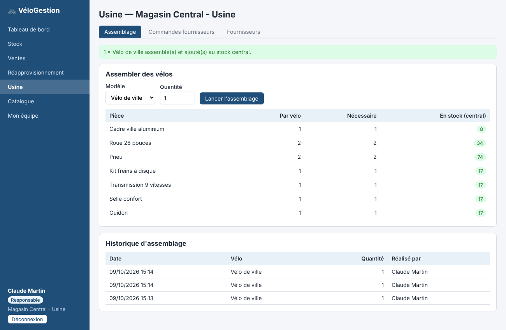

# VéloGestion — gestion des magasins et de l'usine de vélos

Projet d'entretien : application **Java (Spring Boot) + Angular** avec authentification JWT.

L'entreprise fabrique des vélos à partir de pièces détachées achetées à des fournisseurs.
Les vélos sont assemblés au **magasin central**, qui est aussi **l'usine**. Il réapprovisionne
**3 magasins** (Paris, Marseille, Bordeaux) ; chaque magasin a son propre stock, un responsable et des vendeurs.



## Règles métier

| Sujet | Règle |
|---|---|
| Stocks | Un stock par magasin (central + 3 boutiques), avec un seuil d'alerte par produit. |
| Fournisseurs | Seule l'usine commande des pièces ; à la **réception** d'une commande, les pièces entrent dans le stock central. |
| Assemblage | Un vélo a une **nomenclature** (pièces × quantités). Assembler N vélos retire les pièces du stock central et y ajoute N vélos ; refusé si une pièce manque. |
| Réapprovisionnement | Le central **ne vend pas** aux magasins : un responsable de boutique **demande** un transfert, l'usine l'**expédie** (déplacement de stock, sans prix) ou le refuse. |
| Ventes | Un vendeur ou un responsable vend aux clients finaux depuis le stock **de son magasin** (le central vend aussi). Le prix est figé sur la ligne de vente. |

## Les 3 profils

| Profil | Droits |
|---|---|
| **Direction** (`ADMIN`) | Voit tout (stocks de tous les magasins, toutes les ventes), gère l'usine, le catalogue et tous les comptes. Ne vend pas. |
| **Responsable** (`RESPONSABLE`) | Stock et ventes de son magasin, seuils d'alerte, création/désactivation des vendeurs de son équipe. Boutique : demande des transferts. **Responsable du central** : pilote l'usine (fournisseurs, commandes, assemblage, catalogue, expédition des transferts). |
| **Vendeur** (`VENDEUR`) | Consulte le stock de son magasin, enregistre des ventes, voit ses propres ventes. |

Les droits sont contrôlés **côté serveur** (services métier) ; le frontend se contente de masquer ce qui n'est pas accessible.

## Comptes de démonstration

Mot de passe pour tous : `password`

| Identifiant | Profil | Magasin |
|---|---|---|
| `admin` | Direction | — |
| `resp.central` / `vend.central` | Responsable / Vendeur | Magasin Central - Usine (Lyon) |
| `resp.paris` / `vend.paris1` / `vend.paris2` | Responsable / Vendeurs | Magasin Paris |
| `resp.marseille` / `vend.marseille` | Responsable / Vendeur | Magasin Marseille |
| `resp.bordeaux` / `vend.bordeaux` | Responsable / Vendeur | Magasin Bordeaux |

## Lancer le projet

Prérequis : Java 21, Maven 3.9, Node 20.19+ / 22.12+.

```bash
# Backend — http://localhost:8080 (base H2 en mémoire, rechargée à chaque démarrage)
cd backend
mvn spring-boot:run

# Frontend — http://localhost:4200 (les appels /api sont proxyfiés vers le backend)
cd frontend
npm install
npm start
```

Tests d'intégration du backend (authentification, droits, ventes, assemblage, transferts, commandes) :

```bash
cd backend && mvn test
```

Console H2 : http://localhost:8080/h2-console (JDBC URL `jdbc:h2:mem:velodb`, utilisateur `sa`).

## Architecture

```
backend/   Spring Boot 3.5, Java 21
  model/        Entités JPA : Magasin, Utilisateur, Produit (+ Composant = nomenclature), Stock,
                Fournisseur, CommandeFournisseur, Assemblage, Transfert, Vente
  repository/   Spring Data JPA
  service/      Règles métier et contrôles d'accès (Acces.java)
  web/          Contrôleurs REST + gestion des erreurs (ProblemDetail)
  security/     JWT (jjwt), filtre d'authentification, configuration Spring Security
  config/       Jeu de données de démonstration
frontend/  Angular 20 (standalone, signals, zoneless)
  core/         AuthService, intercepteur JWT, guards, ApiService, modèles
  pages/        login, tableau de bord, stock, ventes, réapprovisionnement, usine, catalogue, équipe
```

### API REST principale

| Méthode | URL | Description |
|---|---|---|
| POST | `/api/auth/login` | Connexion → jeton JWT |
| GET | `/api/auth/me` | Utilisateur connecté |
| GET | `/api/tableau-de-bord` | Indicateurs du périmètre de l'utilisateur |
| GET | `/api/magasins` | Liste des magasins |
| GET | `/api/stocks?magasinId=` | Stock (par défaut celui de l'utilisateur) |
| PUT | `/api/stocks/{id}/seuil?valeur=` | Seuil d'alerte |
| GET/POST/PUT | `/api/produits` | Catalogue (vélos + pièces, nomenclatures) |
| GET/POST/PUT | `/api/fournisseurs` | Fournisseurs |
| GET/POST | `/api/commandes` | Commandes fournisseurs |
| POST | `/api/commandes/{id}/reception` · `/annulation` | Réception / annulation |
| GET/POST | `/api/assemblages` | Assemblage de vélos |
| GET/POST | `/api/transferts` | Demandes de réapprovisionnement |
| POST | `/api/transferts/{id}/validation` · `/refus` | Expédition / refus par l'usine |
| GET/POST | `/api/ventes` | Ventes |
| GET/POST | `/api/utilisateurs`, PUT `/api/utilisateurs/{id}/actif?valeur=` | Comptes |

### Choix techniques

- **JWT sans état** : le jeton ne porte que l'identifiant ; l'utilisateur est rechargé à chaque requête,
  donc un compte désactivé perd immédiatement l'accès.
- **Mots de passe** hachés en BCrypt.
- **Verrou optimiste** (`@Version`) sur `Stock` pour éviter que deux ventes simultanées ne fassent passer le stock en négatif (HTTP 409).
- Les opérations qui touchent plusieurs stocks (assemblage, transfert, vente multi-lignes) sont **transactionnelles** : tout ou rien.
- Erreurs renvoyées au format **ProblemDetail** (RFC 7807), affichées telles quelles dans l'interface.

### Pistes d'évolution

Base PostgreSQL + Flyway, pagination et filtres par date, historique des mouvements de stock,
statut « en transit » pour les transferts, rafraîchissement du jeton, tests frontend.
